# Blunt-Keyboard

This keyboard is a 75% keyboard which has a magnetically attatchable numpad to it. It uses a raspberry pi pico rp2040 as the microcontroller for the main keyboard while using a xiao seeed studio rp2040 as the microcontroller for the numpad. This would connect via two usb C cables into my pc. I made this because I really need a new keyboard since my current one cant even play games anymore due to some weird bug in the pcb where it just randomly spams keys, plus I've had it for almost 10 years.

## Assembly

<table>
  <tr>
    <td width="60%">
      On the main part of the keyboard, the pcb is mounted using five mounting holes on the pcb and five standoffs on the base where M2 heatset inserts will sit. On top of these standoffs will go the PCB where it will be screwed into the base. Then the top goes ontop of the pcb/base walls. This is connected via screws going from the bottom to the top
    </td>
    <td width="40%" align="center">
      
    </td>
  </tr>
  <tr>
    <td width="60%">
      The numpad however is screwed in with the threads in the 3d print. This was not a great design choice at the time as I wasn't as experienced with how 3d printers work but I will take the gamble and if it doesn't work I am able to use tape. HOWEVER the pcb is screwed into the base using the same heatset inserts so the pcb will be secured. The key plate is attatched to the top cover with a joint (i forgot the name)
    </td>
    <td width="40%" align="center">
      
    </td>
  </tr>
</table>

For the magnetic attatchements, two 7mm magnets go in two the 7mm wide holes on BOTH the numpad and the main keyboard and is attatched to each part with some basic super glue. With this the two devices can seamlessly attatch and detach. The two components also have seperate microcontrollers, meaning two different usb connections into my pc. I chose this over having the numpad atatch into the main keyboard for first simple firmware and schematic design but also because it means I have a portable numpad.

### Renders

<table>
  <tr>
    <td>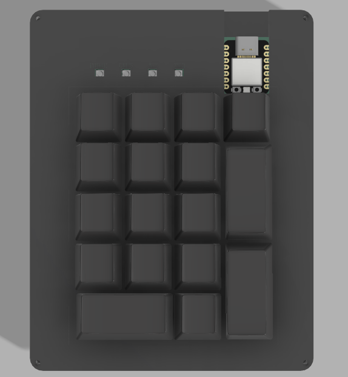</td>
    <td>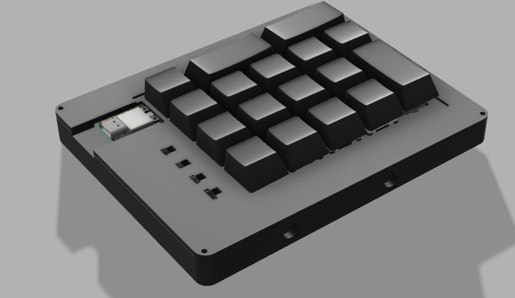</td>
    <td>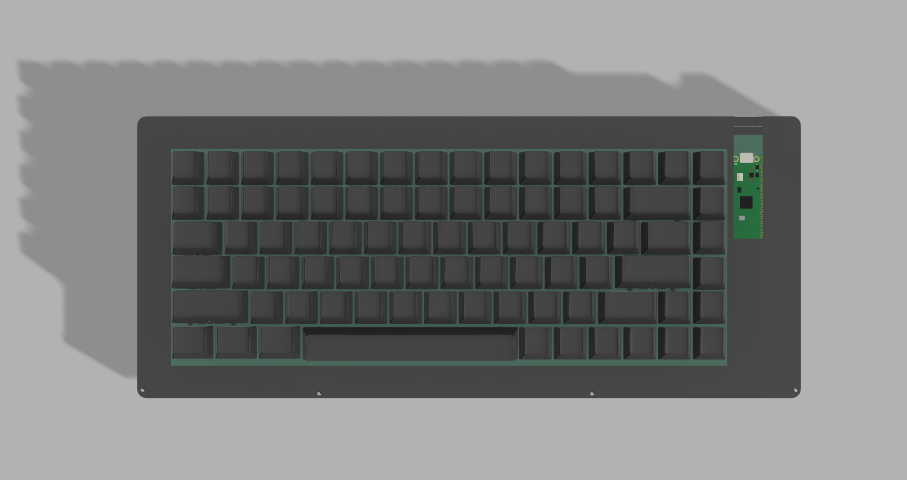</td>
  </tr>
  <tr>
    <td>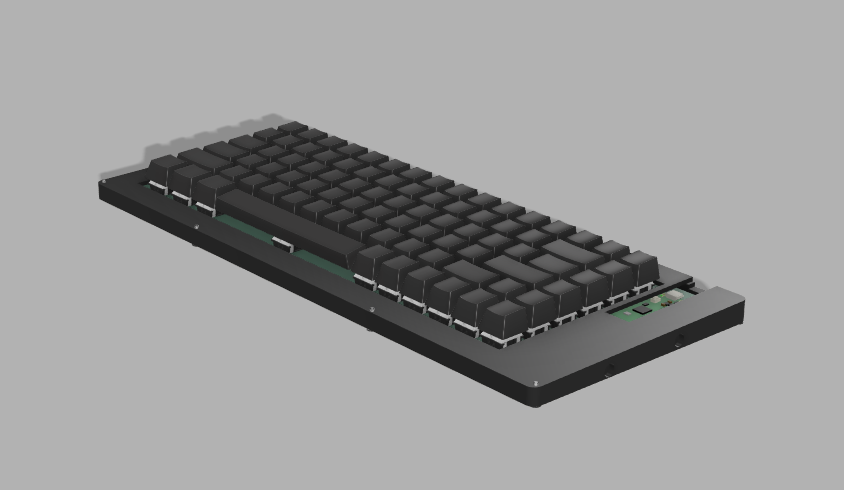</td>
    <td>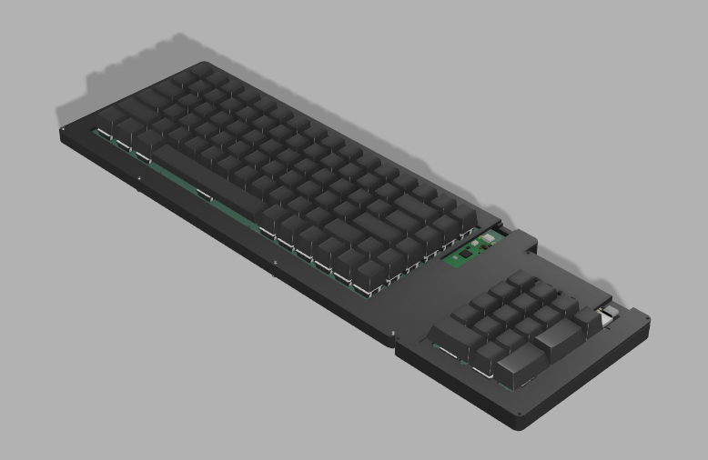</td>
  </tr>
</table>

### Schematic Designs

<table>
  <tr>
    <td>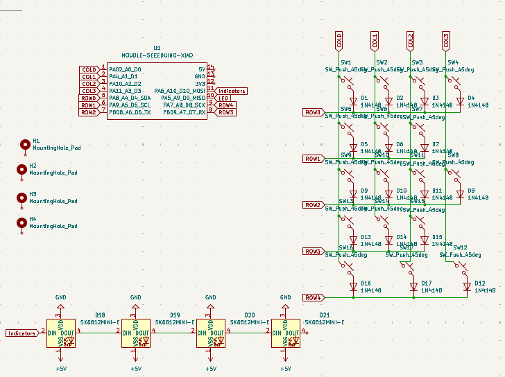</td>
    <td>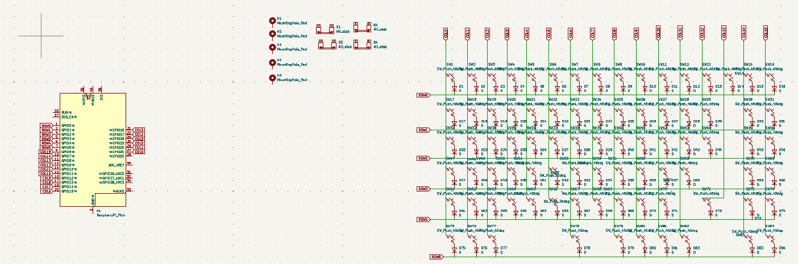</td>
    <td>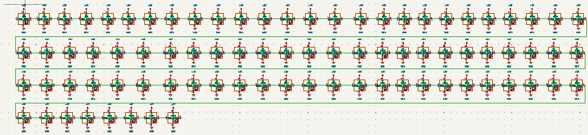</td>
  </tr>
</table>

### PCBs

<table>
  <tr>
    <td>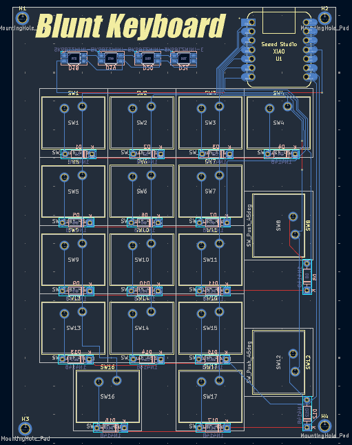</td>
    <td>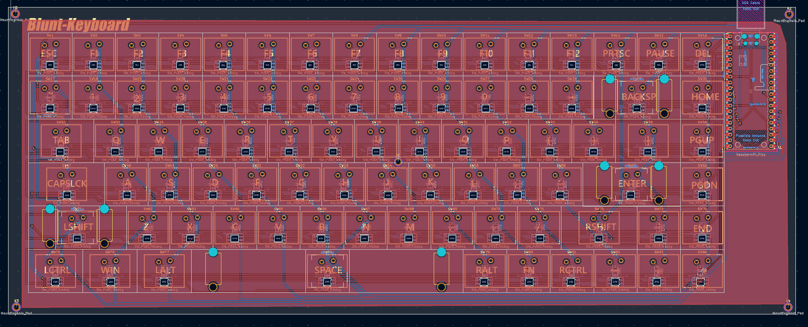</td>
  </tr>
</table>

### Orders

<table>
  <tr>
    <td>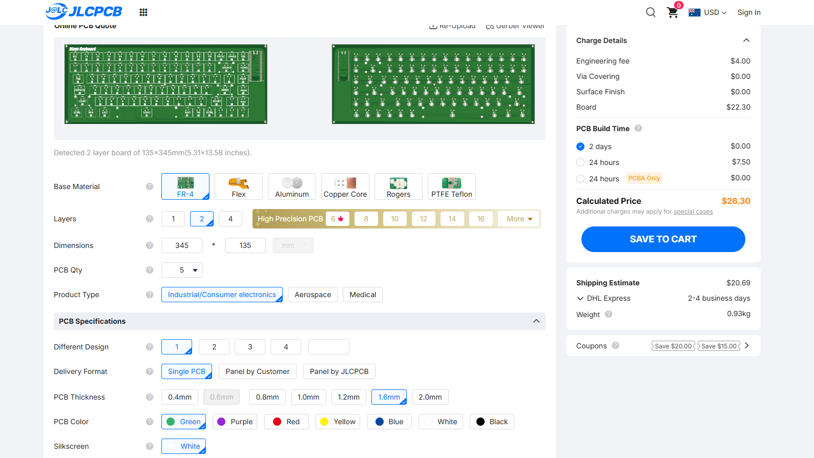</td>
    <td>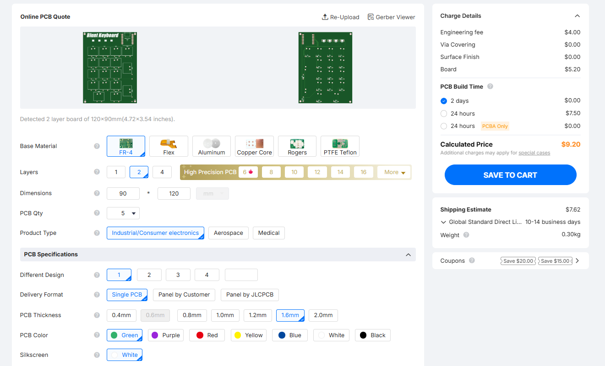</td>
  </tr>
</table>

## BOM

|Product                                                                                                                           |Price |Quantity/MOQ|Subtotal|Links|
|----------------------------------------------------------------------------------------------------------------------------------|------|------------|--------|-----|
|DUROCK Plate Mount Stabilizers V3, Innovative Pre-clipped Stem for Minimum Wire Wobble 2U 6.25U 7U Plate Keyboard Stabilizers V3 (Color: V3 BS 4x2u 1x6.25u)|$7.65|1|$7.65|[link](https://www.aliexpress.com/item/1005006528731543.html?spm=a2g0o.cart.0.0.4c3438dal21w6q&mp=1&pdp_npi=6%40dis%21AUD%21AUD+11.39%21AUD+11.39%21%21AUD+11.39%21%21%21%402103129017855613570607710e1021%2112000037543723481%21ct%21AU%21-1%21%211%210%21&pdp_ext_f=%7B%22cart2PdpParams%22%3A%7B%22pdpBusinessMode%22%3A%22retail%22%7D%7D)|
|110Pcs Outemu Switches for Mechanical Keyboard 3Pin Clicky Linear Tactile Silent Switch RGB LED SMD Gaming Mechan with MX Switch (Color: 110p DustProof Brown)|$29.54|1|$29.54|[link](https://www.aliexpress.com/item/1005011976942889.html?spm=a2g0o.cart.0.0.4c3438dal21w6q&mp=1&pdp_npi=6%40dis%21AUD%21AUD+43.46%21AUD+3.08%21%21AUD+3.08%21%21%21%402103129017855613570607710e1021%2112000057186154978%21ct%21AU%21-1%21%211%210%21)|
|1N4148W (Diode Independent 100V 300mA Surface Mount SOD-123)|$0.008|150|$1.20|[link](https://www.lcsc.com/product-detail/C917030.html)|
|Original Raspberry Pi Pico Development Board, Pico or Pico H with Pin Header, support MicroPython/C++|$6.66|1|$6.66|[link](https://www.aliexpress.com/item/1005008714908011.html?spm=a2g0o.cart.0.0.4c3438dal21w6q&mp=1&pdp_npi=6%40dis%21AUD%21AUD+9.78%21AUD+4.79%21%21AUD+4.79%21%21%21%402103129017855613570607710e1021%2112000046359830441%21ct%21AU%21-1%21%211%210%21)|
|SK6812MINI-EA (SMD-4P, 3.2x2.8mm LED Addressable, Specialty RoHS)|$0.0645|100|$6.45|[link](https://www.lcsc.com/product-detail/C5378731.html)|
|XVX 119 Keys Black Transparent PC Keycaps 60/68/75/87/98/100 Mechanical Keyboard Key Cap Crystal Clear Keycaps for Gaming/Office (Color: black)|$18.69|1|$18.69|[link](https://www.aliexpress.com/item/1005010587844811.html?spm=a2g0o.cart.0.0.675938daAlDdi5&mp=1&pdp_npi=6%40dis%21AUD%21AUD+30.95%21AUD+22.59%21%21AUD+22.59%21%21%21%40210328df17855662600466416e0d9f%2112000052907539638%21ct%21AU%21-1%21%211%210%21)|
|50pcs 5-30mm Anti-slip Black Self Adhesive Round Silicone Rubber Feet Pad Laptops Keyboards Calculators Monitors Anti-skid Pads (Size: OD 15mm, Color: Thick 0.5mm)|$2.18|1|$2.18|[link](https://www.aliexpress.com/item/1005012365785428.html?spm=a2g0o.productlist.main.9.4de19oaH9oaHuB&algo_pvid=cd5a83e3-1229-4647-a495-e3f16f297cca&algo_exp_id=cd5a83e3-1229-4647-a495-e3f16f297cca-8&pdp_ext_f=%7B%22order%22%3A%2210%22%2C%22eval%22%3A%221%22%2C%22fromPage%22%3A%22search%22%7D&pdp_npi=6%40dis%21AUD%212.31%212.31%21%21%211.60%211.60%21%4021030f4a17855681020947549e1149%2112000058187329086%21sea%21AU%210%21ABX%211%210%21n_tag%3A-29910%3Bd%3Aa8aafb62%3Bm03_new_user%3A-29895&curPageLogUid=XU7lr6tnileh&utparam-url=scene%3Asearch%7Cquery_from%3A%7Cx_object_id%3A1005012365785428%7C_p_origin_prod%3A)|
|Pad Specific - 10pcs/1pc RP2040 Seeed XIAO Raspberry Pi Development Board Module For Arduino/MicroPython/CircuitPython (Model Number: 1pc)|$7.58|1|$7.58|[link](https://www.aliexpress.com/item/1005008200917480.html?spm=a2g0o.productlist.main.1.6ac5379cKx7D6w&algo_pvid=b6c6bc21-d979-4d64-972b-8bcf0e8f28f7&algo_exp_id=b6c6bc21-d979-4d64-972b-8bcf0e8f28f7-0&pdp_ext_f=%7B%22order%22%3A%22279%22%2C%22eval%22%3A%221%22%2C%22fromPage%22%3A%22search%22%7D&pdp_npi=6%40dis%21AUD%2120.56%2114.39%21%21%2114.23%219.96%21%402101e81117855657959013083e100a%2112000058130698584%21sea%21AU%210%21ABX%211%210%21n_tag%3A-29910%3Bd%3Aa8aafb62%3Bm03_new_user%3A-29895&curPageLogUid=Gb0bLHPVv7Jw&utparam-url=scene%3Asearch%7Cquery_from%3A%7Cx_object_id%3A1005008200917480%7C_p_origin_prod%3A)|
|Additional LCSC Fees|||  $9.15||
|AliExpress Shipping|||    $6.65||
|PCB (JLCPCB)|||        $52.04||
|Total|||                 $147.79||